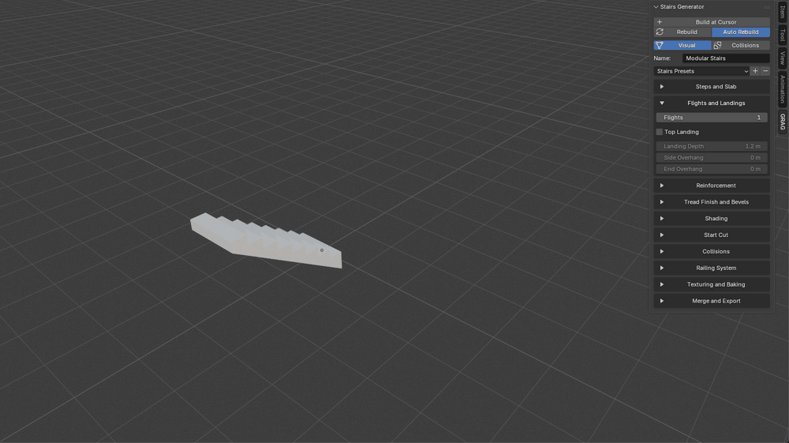

# About

GRAG, the Game Ready Assets Generator, is a Blender extension that builds doors, windows and stairs for games. Every asset is parametric: change a setting in its panel and the asset rebuilds at once, with clean topology, sharp edges, UV seams, collision shapes and moving parts ready for the engine.

## What you get

- **Doors** with flush, slatted, steel and panelled leaves, double leaves, side sections and transoms, many handle styles and locks, fitted to a wall opening.
- **Windows** with fixed panes, opening sashes and French pairs, uPVC or timber profiles, reveals and a sill.
- **Stairs** with straight, L-shaped and U-shaped flights, landings, reinforcement, tread plates and four railing types.

Every asset comes with:

- collision shapes that you can see and edit in Blender, coloured by the body they belong to in the game;
- a draft UV atlas on every rebuild, ready to paint;
- an export for Godot 4, with a Godot add-on that builds the collisions and moving bodies on import;
- an export for Substance 3D Painter, with matching low and high meshes for baking.

## How it works

Each generator keeps its settings on the asset itself, so an asset in a `.blend` can be changed at any time. Building or rebuilding replaces the generated meshes, keeps the materials you assigned and files everything into a collection of its own, with the visual meshes and the collision shapes in separate child collections.

The Godot export writes a GLB and a small manifest next to it. The manifest lists the collision shapes and the parts that move, such as door leaves and window sashes, with their hinge axis and opening angle. The GRAG add-on for Godot reads it when the GLB is imported, so no import script is needed.

## Requirements

- Blender 5.2 or newer.
- Godot 4.7 or newer for the Godot add-on.
- To fit doors and windows to building openings, the Parametric Room Builder add-on. Everything else works without it.
