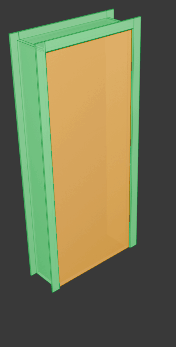
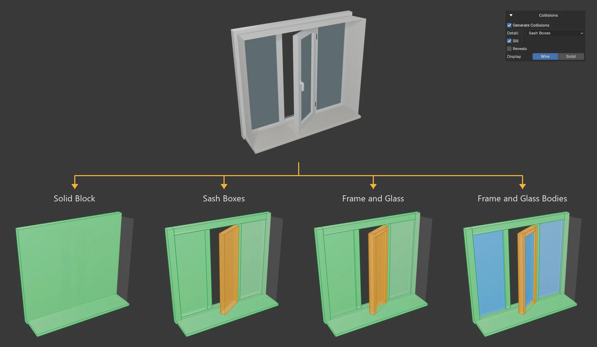

# Collisions

The **Collisions** section starts with **Generate Collisions** (on by default), followed by the switches that choose which parts get collisions, and **Display**, which draws them as **Wire** or **Solid** with an outline. Collision switches rebuild the asset like any other setting.

The generator makes one mesh object per shape in the **Collisions** collection, tagged with its kind in the `grag_collision` property: `BOX`, `BOXES` (one box per connected piece), `CONVEX` or `CONCAVE`. Shapes of a moving part are children of its pivot and turn with it. The Godot export reads these objects, not the settings, so hand edits to them (moving, rotating or scaling a box) reach Godot. **Rebuild** regenerates the shapes but keeps the same objects. To add a shape of your own, put a mesh inside the asset's hierarchy and give it a `grag_collision` property with one of the kinds above; rebuilds leave it alone and the export writes it.

Pivots of parts that move in Godot carry the body metadata `grag_body_id` (the node name in Godot), `grag_body_kind` (`leaf`, `sash` or `glass`) and `grag_motion` (JSON: the hinge axis and opening angle).

