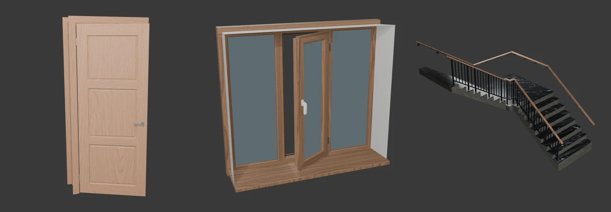

.. GRAG documentation master file.

GRAG Documentation
==================

GRAG generates game-ready doors, windows and stairs in Blender, with collisions, UVs and exports for Godot and Substance 3D Painter.

.. toctree::
   :maxdepth: 2
   :caption: Getting Started

   about.md
   install.md
   workflow.md

.. toctree::
   :maxdepth: 2
   :caption: Generators

   doors.md
   windows.md
   stairs.md
   stairs_railings.md

.. toctree::
   :maxdepth: 2
   :caption: Games and Texturing

   collisions.md
   texturing.md
   godot.md
