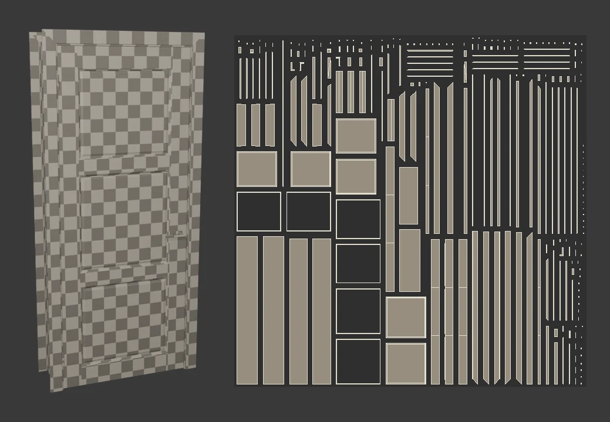
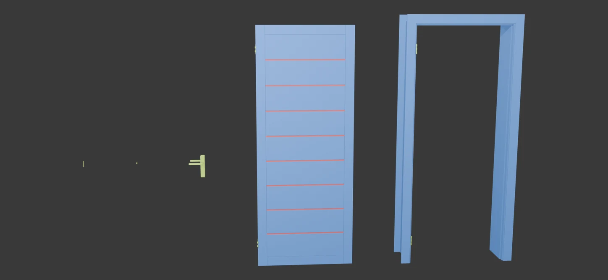

# Texturing and Baking

The **Texturing and Baking** section is the same in every panel:

- **One Material** packs every paintable part into one atlas and one texture set. Without it, each material gets its own atlas. Material assignments in the scene are kept either way.
- Options of the generator, such as the door's **Texture Grain** and bake groups.
- **Prepare Draft UVs** unwraps the current meshes again, keeping their geometry and hand edits. Use it after editing a mesh or changing material assignments.
- **Export for Substance Painter**.

Every **Rebuild** unwraps a draft atlas into the `UVMap` layer. The generator marks seams where it knows them, for example on mitred joints and profiled frames, and the grain direction of wooden parts; a shared UV service unwraps the faces of each texture set, scales the islands evenly, turns wood grain along the chosen texture axis and packs the atlas. Faces without generator seams get their islands by projection. Glass and window reveals keep tiled UVs and stay out of the atlas. Other UV layers, such as an authored one, are kept. Refine the unwrap by hand after the last rebuild or draft.

**Export for Substance Painter** writes `<name>_low.obj` to paint and `<name>_high.obj` to bake Material ID and ambient occlusion, each with its `.mtl`. Both files hold the same meshes with `_low` and `_high` suffixes, so Painter can match them by mesh name. In the low file each material is a texture set, or there is one with **One Material**. In the high file each source material has its own colour for the ID map. The export uses the closed pose. Parts in different bake groups are moved apart along X by 0.5 m so they do not occlude each other, and helper geometry that only adds ambient occlusion is in the high file only. In Painter:

1. Create the project from `_low.obj`. Keep each OBJ next to its MTL. [Painter project creation](https://experienceleague.adobe.com/en/docs/substance-3d-painter/using/getting-started/project-creation)
2. In **Bake Mesh Maps**, add `_high.obj` to **High Definition Meshes** and set **Match → By Mesh Name** with the `_low` and `_high` suffixes. For the **ID** map, set **Color Source → Material Color**. [Mesh map settings](https://experienceleague.adobe.com/en/docs/substance-3d-painter/using/baking/mesh-map-settings) · [Matching by name](https://experienceleague.adobe.com/en/docs/substance-3d/bakers/features/matching-by-name)
3. For **Ambient Occlusion**, set **Self Occlusion → Always** so helper geometry occludes the paintable parts. For local occlusion, turn off **Relative to Bounding Box** and start with **Max Occluder Distance** 0.35 m. [AO settings](https://experienceleague.adobe.com/en/docs/substance-3d/bakers/bakers-settings/ambient-occlusion-from-mesh)
