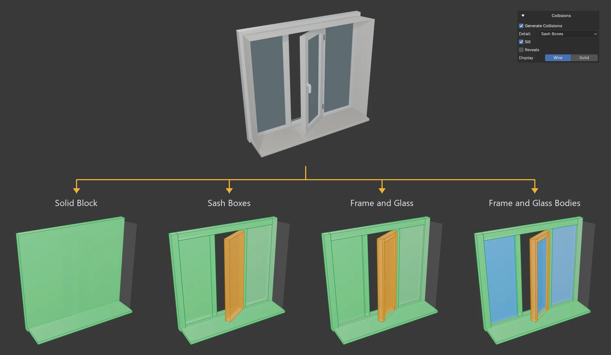

# Windows

## Creating windows

1. For a standalone window, set the opening in **Opening and Walls** and press **Build at Cursor**. For a window in a Room Builder plan, select a window opening in **Openings** or its **Window Box** object and press **Build in Opening**.
2. Choose a layout from the **Window Presets** menu, then adjust the number of sections, their hinges and their width ratios. Hinge sides are seen from outside.
3. To preview an open pose, set **Preview Opening**. After the opening changes, press **Sync to Opening**.

| Preset | Sections from left to right, seen from outside |
| --- | --- |
| **Single Fixed Pane** | One fixed pane |
| **Two Fixed Panes** | Two fixed panes |
| **Two Panes, Right Sash** | A fixed pane and a right sash |
| **Three Fixed Panes** | Three fixed panes |
| **Three Panes, Center Sash** | Fixed pane, centre sash, fixed pane |
| **French Pair, No Fixed Post** | Two sashes hinged on the outer edges; the right one carries a meeting stile over the centre joint |

## Parameters

**Sections.** **Sections** sets one to three sections, each with a hinge type (**Fixed Glass**, **Left Hinge** or **Right Hinge**) and a width ratio. **French Pair Without Fixed Post** turns two sashes into a pair without a mullion.

**Sashes and Hardware.** **Handle Style** chooses the handle of opening sashes: **Match Window Profile** takes the **Modern Lever** for uPVC and the **Curved Round Pull** for timber; either can be chosen directly, as can the **Flat Strap Pull** or **None**. The mounting plates are solid and the handle belongs to the sash's moving hardware mesh. **Handle Height** places the handle from the bottom of the sash, 0.5 being the middle; near the ends the generator keeps the whole handle on the stile. **Interactive Sashes in Godot** makes opening sashes separate bodies in Godot. **Opening Angle** sets how far sashes open.

**Frame and Glazing.** **Joinery Profile** is **uPVC**, with a chamfered approach to the stop, or **Traditional Timber**, with a square outer rebate, an inner sash quarter and a timber material; both are simplified inward-opening windows. [uPVC sections by GLOBHAUS](https://www.globhaus.com/cad/) · [Timber window drawings by JM Joinery](https://jmjoinery.co.uk/windows/timber-windows/flush-casement-windows/) **Frame Width (Top and Sides)**, **Bottom Frame Width** (0 uses the frame width) and **Frame Depth** size the frame; **Frame Overlap Into Wall** lets it reach into the wall; **Frame Bevel** chamfers the exposed aperture edges, 6 mm by default. The stepped joint has an outer stop on the frame and an inner lap on the sash, with a gasket on the stop's shelf; **Frame Stop Width**, **Sash Overlap** and **Minimum Sash Clearance** set it, and the generator widens the clearance when the sash corner's path needs it. **Mullion Width** and **Sash Profile Width** size the members, and **Glazing Thickness** and **Glass Offset** place the glazing.

**Reveals and Sill.** **Reveal Angle** slopes the three inner reveals toward the frame. **Sill Projection Into Room**, **Sill Thickness** and **Sill Bevel** shape the inner sill.

| Part | Rule |
| --- | --- |
| Frame (`Frame`) | Outer frame, fixed mullions and outer stops form one connected mesh. Its outer edge may touch the wall or reach into it. |
| Reveals (`Slopes`) | Left, right and top reveals form one mesh with shared vertices at the top corners. They meet the opening edges exactly on the inner wall face and angle toward the frame. There is no bottom reveal. |
| Sill (`Windowsill`) | Its bottom lies exactly on the opening's bottom plane, `Z = 0` in asset space. It meets the frame and may project into the room; its bevel keeps a flat bearing. |
| Sash (`SashNN…`) | Two hinges share one axis; the sash origin is at the centre of the lower hinge pin. Pins and fixed hinge plates belong to `FrameHinges`; moving hinge halves and the handle belong to the sash hardware. |

In a French pair the left sash opens first and the right one, with the meeting stile, second; they close in reverse. The generator checks that the chosen angle lets the meeting stile pass the open left sash, and **Preview Opening** shows the sequence. [Meeting stile in Liniar French windows](https://www.liniar.co.uk/upvc-windows/french) The handles and hinges are smooth on rounded surfaces and sharp at hard joints.

## Axes and origin

`Window` is the asset root. Its origin is where the outer and inner walls meet, at the middle of the opening width and on its bottom plane; in Room Builder that is the wall contour at the level height plus the opening's bottom offset. +Z points up, +Y into the room perpendicular to the wall and X along the opening width, in metres. In Godot, +Y is up and the room side is −Z.

If `d_ext` and `d_int` are the distances from the joint to the outer and inner wall faces, those faces lie at `Y = −d_ext` and `Y = +d_int`. The middle plane of the fixed frame and glazing lies at `Y = (d_int − d_ext) / 2 + offset`, where **Glass Offset** is 0 by default and positive toward the room. Each sash with its glazing sits further into the room, behind the frame's outer stop. Fitting to an opening takes the width, height, bottom level, inward direction and both wall depths from it; a standalone window takes its position from the cursor.

## UV and texturing

The profiles are unwrapped strictly along the generator's seams:

- Each diagonal joint of a sash has a seam through the whole cross-section, across faces, bevels and the inner and outer profile.
- The top and bottom frame rails unwrap as whole pieces; their ends and the outer faces of the stiles are separate islands, and cross seams separate stiles from rails through the whole section.
- The inner surface of a fixed opening is split by a closed seam in the glass mid-plane; in an opening section the seam uses the loop where the stop meets the inner surface.
- Two closed seams along the sash's outer outlines and cross seams in every corner separate its four outer islands.
- Each gasket ring in `FrameSeals` has seams through the section at all four corners and along its outer edge on the stop side, so each side unwraps as one narrow strip.

Handles, hinges and the sill get their islands by projection. **One Material** is on by default for windows: all painted parts share one atlas and one texture set. The GLB has three materials: `slopes` (reveals, tiled UVs), `glass` (all glazing, tiled UVs) and `frame` (frame, sash profiles, gaskets, hardware and inner sill, on the shared atlas). In Blender each part keeps its own material for the Material ID bake.

## Collisions

**Collision Detail** sets how closely the collisions follow the window. All shapes are boxes, except the reveals.



| Detail | Frame | Sashes | Glass |
| --- | --- | --- | --- |
| **Solid Block** | One `WindowCollision` box over the frame's outer size, at frame depth | No shapes of their own. Sashes stay closed in Godot, even with **Interactive Sashes in Godot**: their meshes export closed under the root | Inside the block |
| **Sash Boxes** (default) | Boxes for the stiles, top and bottom rails, mullions and stop shelves; a window without sashes gets one `WindowCollision` | One `SashNNCollision` box per sash | Fixed glazing is covered by a box at full frame depth |
| **Frame and Glass** | As **Sash Boxes**, also for fixed windows; boxes follow the frame members without bevels | Four boxes along the sash profile: `SashNNLeft`, `Right`, `Bottom`, `Top` | A thin `GlassNNCollision` box as thick as the glazing unit for each pane |
| **Frame and Glass Bodies** | As **Frame and Glass** | As **Frame and Glass** | As **Frame and Glass**, with each pane's box under its own `GlassNNBody` empty, which becomes a separate `StaticBody3D` in Godot |

The frame depth sets the depth of the main boxes; sash boxes sit further into the room with their profile, and outer stop boxes cover only their shelf, leaving the sash room to open inward. An opening sash has a simple shape of its own in its hinge's space; static boxes leave its opening free, so it can turn through its full range without catching on the frame, reveals or sill. **Sill** (on by default) adds a box for the inner sill; **Reveals** (off by default) adds convex shapes for the three reveals, from the same eight points as their meshes, that leave the opening free.

A `GlassNNBody` sits at the centre of its pane. In Blender, the pane body of a sash is a child of the sash pivot and turns with it. In the manifest, the pane of an interactive sash is nested in the sash body; panes of fixed sections and of sashes that stay closed belong to the root. Each pane body has `grag_body_kind` `glass`, for its own collision layer, physics material or breaking logic. Without **Generate Collisions** the manifest still has the interactive sash bodies and their motion, but no shapes.

## Export for Godot

With **Merge**, the fixed parts join into `WindowMesh` under the root and each interactive sash into `SashNNMesh` under its pivot; without it the GLB keeps the separate parts. **Separate Handles** in **Merge and Export** exports each handle as its own mesh `SashNNHandle` directly under its sash node, turning around its local Z, with the rose staying on the sash. When the sash does not open in Godot, the handle is a child of the sash's visual mesh. Imported in Godot, for one interactive sash with a sill collision:

```text
Window                       Node3D, or StaticBody3D with Root Type
├── WindowMesh               MeshInstance3D (frame, reveals, sill)
├── StaticCollision          StaticBody3D for the fixed shapes
│   ├── FrameLeftCollision   CollisionShape3D
│   ├── FrameRightCollision
│   ├── FrameTopCollision
│   ├── FrameBottomCollision
│   ├── FrameStop01…Collision (the four stop shelves)
│   └── WindowsillCollision
└── Sash01                   AnimatableBody3D on the hinge axis
    ├── Sash01Mesh           MeshInstance3D
    └── Sash01Collision      CollisionShape3D
```

Sash ids follow their sections, such as `Sash01` and `Sash02`. Each sash's `grag_motion` has the local `axis`, `closed_degrees` `0` and `open_degrees`, signed by direction; on the right sash of a French pair, `requires_open` names the sash that must open first. Without **Interactive Sashes in Godot**, the sash meshes and their shapes are exported closed under the root.

## Export for Substance Painter

Glass is left out of both files. Each sash is a bake group moved apart along X, at least 0.5 m from the wall and from other sashes. The reveals and an exterior wall, `ExteriorWall_high`, are only in the high file, for ambient occlusion: the wall's outer plane lies at **Exterior Wall Depth** and its opening faces run from it to the frame's outer plane. **Exterior Sill Thickness** raises the bottom of that exterior opening by the thickness of an outside sill (0 m by default); export again after changing it. With **One Material** the low file has one texture set, `Window_Paint`.

## Use in a game scene

1. Place `Window` at the middle of the opening's bottom edge on the wall joint plane, facing the room, and check the fit in vertical and horizontal sections. For another opening size, generate a matching window in Blender.
2. Check the imported tree and shapes. A closed sash's shape covers its opening; open, the opening must be free of static shapes. Check the motion from closed to fully open with the collisions this instance uses.
3. Drive each sash body found by `grag_body_id`. For force-driven opening, replace it with a `RigidBody3D` and pin it to the fixed root with a `HingeJoint3D`, using its pivot, axis and the limits from `grag_motion`. [HingeJoint3D](https://docs.godotengine.org/en/stable/classes/class_hingejoint3d.html)
