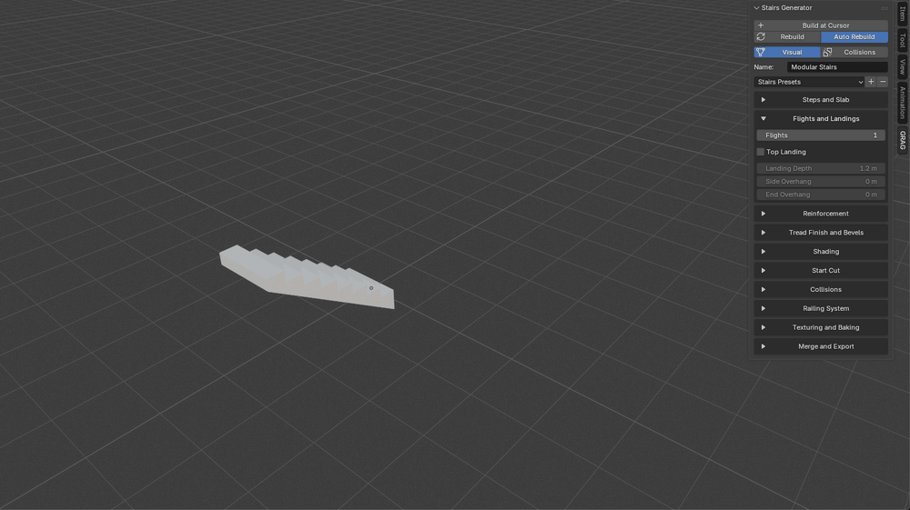

# Working with the Panels

The three panels share the same top, sections and data, so this section applies to doors, windows and stairs alike.

## Panel

1. **Build at Cursor** builds a new asset at the 3D cursor. If an asset of the same type is selected, the new one copies all its settings; otherwise it uses the scene template, which the panel shows when nothing is selected.
2. **Rebuild** and **Auto Rebuild**. With **Auto Rebuild** (on by default) every setting that shapes the asset rebuilds it at once. If the settings are impossible, the previous geometry stays and the panel shows the error. A manual **Rebuild** also reports the error as a Blender message. Turn **Auto Rebuild** off while changing many settings, then press **Rebuild**.
3. **Visual** and **Collisions** show or hide the asset's two collections.
4. The asset's name.
5. The preset menu with **+** (save the current settings) and **−** (remove the active preset). Built-in presets ship with the extension; saved ones go to `presets/grag/<asset>` in Blender's scripts folder. A preset applies to the selected asset, or to the scene template, and rebuilds the asset once.

Below the presets, only the style stays outside the collapsible sections. At first, only the first section with the dimensions is open. All settings are stored on the asset's root object and saved in the `.blend`. Selecting any part of an asset opens the asset in its panel. Switch to Object Mode before rebuilding; hand edits to generated meshes are replaced by the next rebuild.

No timers or handlers run in the background. Registering the extension or opening a file never rebuilds anything; assets change only when you edit them.

## Collections

Every asset has a collection named after it, with two children:

| Collection | Contents | Default |
| --- | --- | --- |
| `<Asset> · Visuals` | The generated meshes | Visible |
| `<Asset> · Collisions` | One object per collision shape, and the empties of bodies that have only collisions | Hidden |

The asset's root and the pivot empties of moving parts stay in the asset collection; the root of stairs is the stair mesh, so it is in **Visuals**. The **Visual** and **Collisions** buttons are the eye icons of these two collections in the Outliner, so the panel and the Outliner always agree and other assets are not affected. Hidden meshes and collisions are still exported. Every build files the objects into these collections again.

## Merge

**Merge** joins the meshes in the scene on **Rebuild**, by the same rules as the Godot export: the fixed parts into one mesh and the parts of each moving body into another. Every face of a merged mesh remembers the part it came from, so draft UVs, bake groups and both exports work part by part, and assigned materials survive rebuilds. After turning **Merge** off and rebuilding, the asset is made of separate parts again. If **Merge** changes while **Auto Rebuild** is off, the panel asks for a rebuild.
